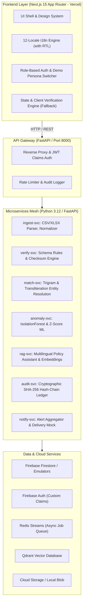

# APAAR-Verify System Architecture

## Overview
APAAR-Verify is a comprehensive, production-shaped student data management and verification platform built around the APAAR ID (One Nation, One Student ID) initiative under NEP 2020 for AICTE institutions.

---

## Microservices Breakdown
| Service | Primary Responsibility | Port | Key Technologies |
|---|---|---|---|
| `api-gateway` | Routing, authentication, rate limiting, request tracing | 8000 | FastAPI, httpx, PyJWT |
| `ingest-svc` | File upload handling, chunking, streaming CSV/XLSX normalization | 8001 | Pandas, OpenPyXL, Pydantic v2 |
| `verify-svc` | Schema rules, Luhn check-digit, Mock government registry adapters | 8002 | Pydantic v2, Great Expectations pattern |
| `match-svc` | Phonetic, trigram, Indic transliteration duplicate detection | 8003 | RapidFuzz, Jellyfish, Indic-Transliteration |
| `anomaly-svc` | Statistical z-score and Isolation Forest outlier detection | 8004 | Scikit-Learn, LightGBM, NumPy |
| `rag-svc` | Multilingual policy Q&A with dense/sparse retrieval and citations | 8005 | Qdrant, FastEmbed / SentenceTransformers |
| `audit-svc` | Append-only SHA-256 hash-chain verification & tamper detection | 8006 | Cryptography, hashlib |
| `notify-svc` | In-app alerts, email/SMS simulation, anomaly threshold alerts | 8007 | Jinja2, asyncio |

---

## Security & Data Privacy (DPDP Act 2023)
1. **Zero Real PII:** Built entirely with realistic synthetic generators.
2. **Adapter Pattern for Government APIs:** All integrations (`ApaarRegistryAdapter`, `DigiLockerAdapter`, `AadhaarAuthAdapter`) sit behind clean Python protocols and TypeScript interfaces with mock implementations.
3. **Role-Based Masking:** AICTE officers view aggregated patterns and masked PII (`APAA••••••••`, `S*** K****`), while institution registrars have scoped access to their enrolled students.
4. **Consent-Driven Access:** Third-party verifiers require a valid cryptographic student consent token before inspecting academic credentials.
5. **Tamper-Evident Hash Chains:** Every verification step produces a cryptographic event hash chaining backward to genesis, verifiable at any time via `/audit/verify`.
