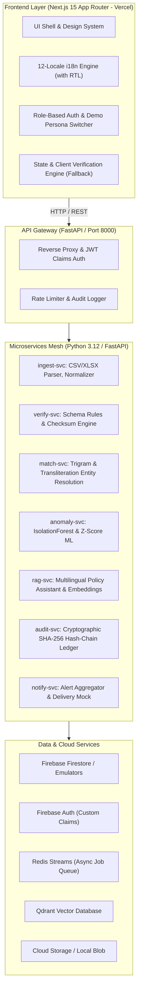

# APAAR-Verify System Architecture

## Overview
APAAR-Verify is a comprehensive, production-shaped student data management and verification platform built around the APAAR ID (One Nation, One Student ID) initiative under NEP 2020 for AICTE institutions.

---

## Microservices & Execution Classification
| Service / Component | Port | Execution Mode | Classification | Implementation Status & Details |
|---|---|---|---|---|
| `web-engine` (`apps/web`) | 3000 | Browser / Vercel | **Implemented (Browser-Only)** | Self-contained client-side engine running verification, Luhn checksums, and WebCrypto SHA-256 hash chains with zero backend required. |
| `verify-svc` | 8002 | Python 3.12 / FastAPI | **Implemented (Live Service)** | Schema validation, Luhn check-digit verification, and cryptographic hash-chain append endpoint. Verified with pytest. |
| `match-svc` | 8003 | Python 3.12 / FastAPI | **Implemented (Live Service)** | Phonetic blocking, cross-script Indic transliteration normalization, and duplicate cluster resolution. Verified with pytest. |
| `anomaly-svc` | 8004 | Python 3.12 / FastAPI | **Implemented (Live Service)** | Statistical outlier scoring and sanctioned intake ratio analysis (>120% capacity). Verified with pytest. |
| `rag-svc` | 8005 | Python 3.12 / FastAPI | **Implemented (Live Service)** | Multilingual semantic retrieval over official AICTE/NEP policy corpus with citations and prompt-injection guardrails. Verified with pytest. |
| `audit-svc` | — | Integrated | **Implemented (Integrated)** | Cryptographic hash-chain ledger implemented directly inside `verify-svc` (8002) and mirrored in `apps/web/src/lib/pipeline.ts`. |
| `notify-svc` | — | Simulated | **Implemented (Browser-Side)** | Regulatory alert feed displaying flagged institutions and intake inflation warnings. |
| `api-gateway` | 8000 | Reverse Proxy | **Specification / Container** | Reverse proxy routing and rate limiting defined in Docker Compose and Kubernetes ingress manifests. |
| `ingest-svc` | — | Job Worker | **Specification / Queue** | High-volume streaming upload worker specification for asynchronous Redis Streams queueing. |

---

## Security & Data Privacy (DPDP Act 2023)
1. **Zero Real PII:** Built entirely with realistic synthetic generators.
2. **Adapter Pattern for Government APIs:** All integrations (`ApaarRegistryAdapter`, `DigiLockerAdapter`, `AadhaarAuthAdapter`) sit behind clean Python protocols and TypeScript interfaces with mock implementations.
3. **Role-Based Masking:** AICTE officers view aggregated patterns and masked PII (`APAA••••••••`, `S*** K****`), while institution registrars have scoped access to their enrolled students.
4. **Consent-Driven Access:** Third-party verifiers require a valid cryptographic student consent token before inspecting academic credentials.
5. **Tamper-Evident Hash Chains:** Every verification step produces a cryptographic event hash chaining backward to genesis, verifiable at any time via `/audit/verify`.
